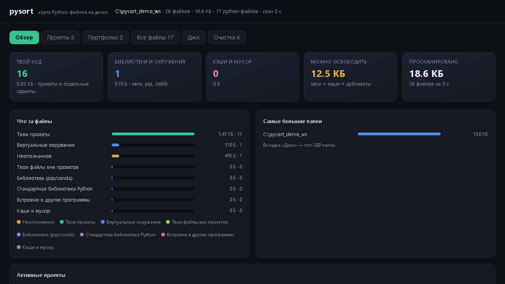
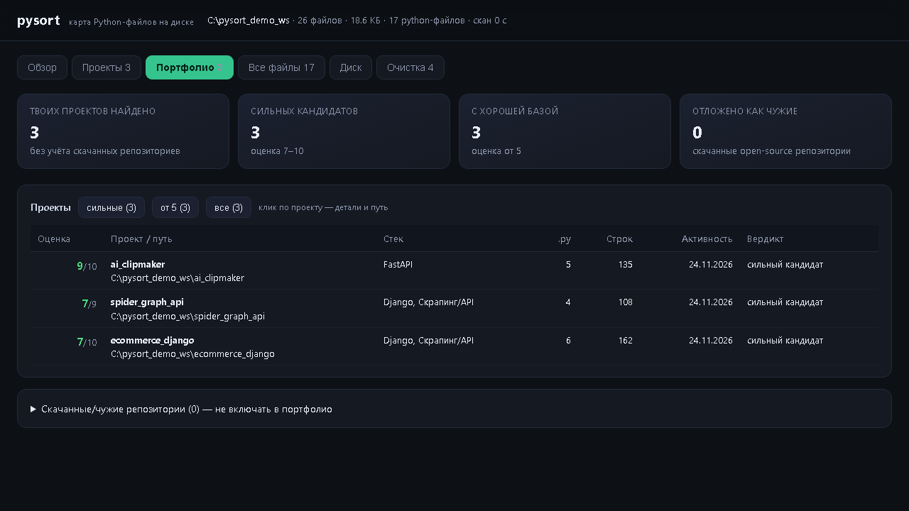
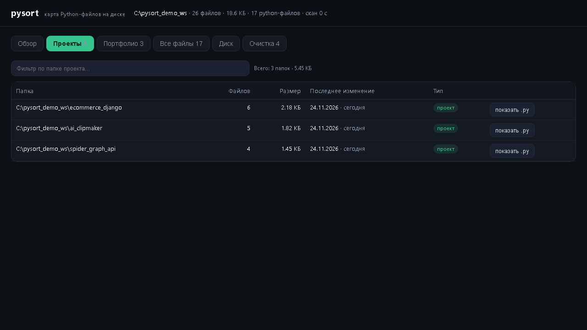
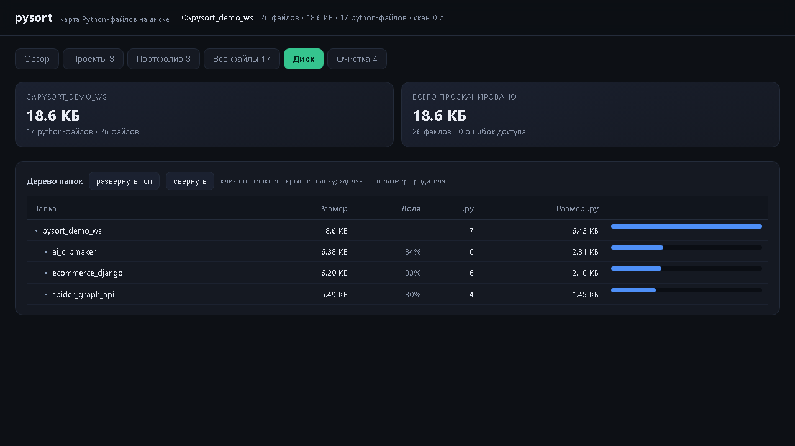
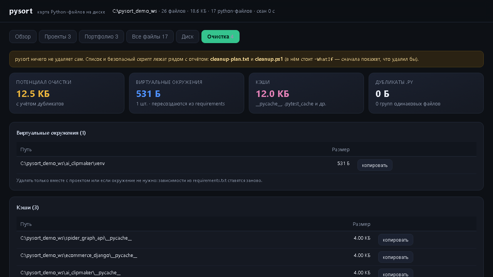

# 🗂️ pysort — карта Python-файлов и аудит проектов на диске

Быстрый сканер дисков и классификатор Python-кода на чистой стандартной библиотеке **Python + SQLite**. Находит все `.py` / `.pyw` / `.pyi` / `.ipynb` / `.pyx` файлы, отделяет ваши проекты от `venv`, `site-packages`, стандартной библиотеки и скачанных чужих репозиториев, строит **автономный HTML-отчёт**, рейтинг портфолио и безопасный план очистки.


---

## 🎬 Видеодемонстрация

📹Смотреть демо-видео

https://github.com/user-attachments/assets/06c0dd3f-fd61-417c-9960-cde6fbd2ffe6


*(Для GitHub: при редактировании `README.md` на сайте перетащите `assets/demo.mp4` в текст **отдельным абзацем с пустыми строками сверху и снизу** — GitHub заменит ссылку на встроенный видеоплеер.)*

---

## 📸 Интерфейс отчёта (`out/report.html`)

### Обзор и распределение кода


### Портфолио и оценка проектов


### Проекты, дерево диска и план очистки
| Проекты | Дерево диска | Очистка |
|---|---|---|
|  |  |  |

---

## ✨ Что умеет

| Категория | Как классифицируется |
|---|---|
| **Твои проекты** | папки с `.git`, `pyproject.toml`, `requirements.txt`, `.idea` и т.п. |
| **Твои файлы вне проектов** | отдельные скрипты на рабочем столе, в `Documents`, `Downloads` |
| **Виртуальные окружения** | `venv`, `.venv`, `env`, conda-окружения |
| **Библиотеки (pip/conda)** | `site-packages`, `dist-packages`, conda `pkgs` |
| **Стандартная библиотека Python** | системные каталоги установки Python (`Lib\...`) |
| **Встроено в другие программы** | `Program Files`, `AppData`, `Windows` |
| **Кэши и мусор** | `__pycache__`, `.pytest_cache`, `.mypy_cache`, pip cache |
| **Неопознанное** | спорные файлы (при желании уточняются через LLM) |

Результат — один автономный файл `out/report.html` (открывается двойным кликом без интернета) с 6 вкладками (**Обзор**, **Проекты**, **Портфолио**, **Все файлы**, **Диск**, **Очистка**), плюс CSV-выгрузки, `portfolio.md` и `cleanup.ps1` с безопасным флагом `-WhatIf`.

**pysort ничего не удаляет и не перемещает сам.**

---

## 🚀 Быстрый старт

Зависимостей нет — только стандартная библиотека **Python 3.9+**.

```bat
git clone https://github.com/vztyz/pysort.git
cd pysort
pysort.cmd all --open
```

Или по шагам:

```bat
python main.py scan          :: просканировать все диски
python main.py classify      :: разложить по категориям
python main.py report --open :: собрать и открыть отчёт
```

Если на Windows установлен **WizTree** — pysort находит его автоматически (`--backend auto`) и читает индекс MFT в разы быстрее (через `pysort-admin.cmd` от администратора — за десятки секунд). Без WizTree работает встроенный кросс-дерево обход на `os.scandir`.

Полезные флаги:

```bat
:: только конкретные папки
python main.py all --roots C:\Projects D:\Work --open

:: исключить папку
python main.py all --exclude "C:\Users\user\OneDrive"

:: принудительно выбрать бэкенд
python main.py all --backend python --open
```

---

## 🤖 AI-сортировка (опционально)

Правила закрывают большинство случаев. AI подключается только для спорных файлов (уверенность правил < 80%) с кэшированием ответов в `pysort.db`:

```bat
:: локальная бесплатная модель (Ollama)
ollama pull qwen2.5-coder:7b
python main.py all --ai ollama --ai-model qwen2.5-coder:7b --open

:: OpenAI / DeepSeek
set OPENAI_API_KEY=sk-...
python main.py all --ai openai --open
```

---

## 📁 Структура проекта

```text
pysort/
├── main.py           # CLI: scan / classify / report / portfolio / all / open
├── scanner.py        # Встроенный обход дисков (os.scandir), размеры папок, маркеры
├── wiztree.py        # Быстрый бэкенд через WizTree CLI + импорт CSV
├── classify.py       # Правила категоризации + применение AI с кэшем
├── portfolio.py      # Оценка проектов 0–10, определение стека, отделение чужих репо
├── ai.py             # Клиент Ollama / OpenAI / DeepSeek (через urllib)
├── report.py         # Генератор автономного HTML-отчёта, CSV и cleanup.ps1
├── db.py             # Схема и слой работы с SQLite
├── pysort.cmd        # Быстрый запуск
└── pysort-admin.cmd  # Запуск с правами администратора для MFT-скана WizTree
```
